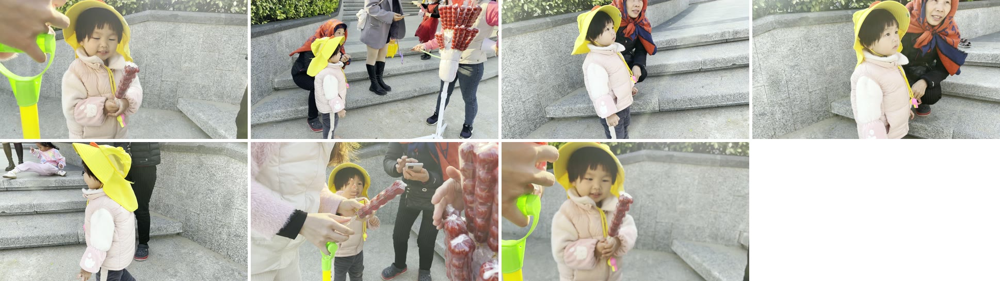

# 案例集 (`cases/`)

这里的案例是**真实剪辑项目**，不是为写文档造的示例。每个案例都包含：
成片小样、决策报告、以及**成片实测数据**（不是源素材的估算值）。

> 视频文件是 720p 展示小样；4K 原片体积过大，**不随仓库分发**。
> 案例源素材均为本人自拍自有素材。

---

## 案例 01 · 家庭出游 17s 横版短片

**7 镜头 / 17.02s / 3840×2160 / 60fps** · 源素材 4K 60fps 家庭出游片段

用 6 个 skill 走完一次完整剪辑：审计发现 2 处违规 → 修复 → 复检通过。

- 发现：C1→C2 **同场景方向相反**（左 / 右）未翻转；C3/C5 活跃场景 6s 未缩短，节奏单调
- 修复：C2 水平翻转 + 时长改 `7→4→3→3→3→6→7` 波浪节奏
- 结果：最终交付 `douyin_final_17s_h264_16x9.mp4`（17.02s / 4K / 60fps / 含 AAC 音轨）

→ [案例详情](01-shot-transition-17s/README.md) · [决策报告](01-shot-transition-17s/decision-report.md) · [审计报告](01-shot-transition-17s/audit-report.md)

---

## 案例 02 · 《她的一天》五部 HDR 故事线短片

**5 条 / 84–99s / 2160×3840 / HEVC 10-bit HLG / 30fps** · 972 条手机素材中筛出 256 条原生 HLG

把方法论扩展到**批量竖屏 HDR 叙事**：数据驱动的 5 条不同故事线，张艺谋风格，
114 个去重镜头，与第一版 SDR 零素材重复。

- 方向三模式：`auto`（旋转标签自动旋转）/ `crop`（真横屏中心 9:16 裁切）/ `port`（竖屏直缩放）
- 真 HDR：`hevc_nvenc main10` + bt2020 / HLG（`arib-std-b67`）；SDR 标题卡用 `zscale` 单步转 HLG
- 工程：4K 10-bit 软编仅 0.45fps → NVENC 快约 44 倍；concat 必须重编码（否则接缝 non-monotonic DTS）
- 选材：剔除画中脸 / 文字模板 / 屏幕录制 / 成人主体等“脏素材”；只用原生 HLG，不混 SDR 旅行批
- 验收：全片 decode 错误 0；峰值 −2.7~−4.2dB 无削波；规格 5 条一致
- 结果：上学日 96.4s / 追风 84.0s / 牵着你的手 98.7s / 童话 86.4s / 去看世界 95.8s（4K 成片不随仓库分发）

→ [案例详情](02-her-day-hdr/README.md) · [HDR 流水线工具](../tools/hdr/README.md) · [故事线配置](../tools/hdr/storylines.py)

---

## 这个案例示范了什么

| 环节 | 案例 01 做法 | 案例 02 扩展 |
|---|---|---|
| 选材 | 光流扫描 + DP 选镜 | 素材盘点（`is_hlg` 判定）+ 抽帧 contact sheet 人工复核 |
| 方向 | 同场景水平翻转 | 三模式（auto/crop/port）统一到 2160×3840 |
| 叙事 | 单条 7 镜波浪节奏 | 数据驱动 5 条故事线（章节 + 取点）批量出片 |
| 色彩 | 保留源片 | 原生 HLG + 标题卡 zscale 转 HLG，输出真 HDR |
| 渲染 | 帧精确硬切 | NVENC main10 硬件编码 + concat 重编码连续时间线 |
| 复检 | 对成片做光流分析 | 全片 decode 扫描 + 抽帧 + 音量/规格回读 |

拉片教程（[`tutorial/`](../tutorial/)）以案例 01 的成片为例逐镜复盘 6 个 skill，适合作为入门读物先看。
